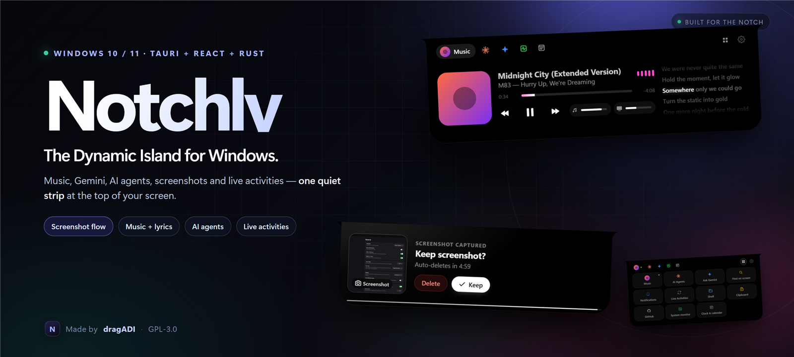
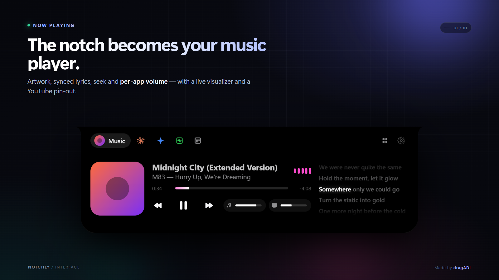
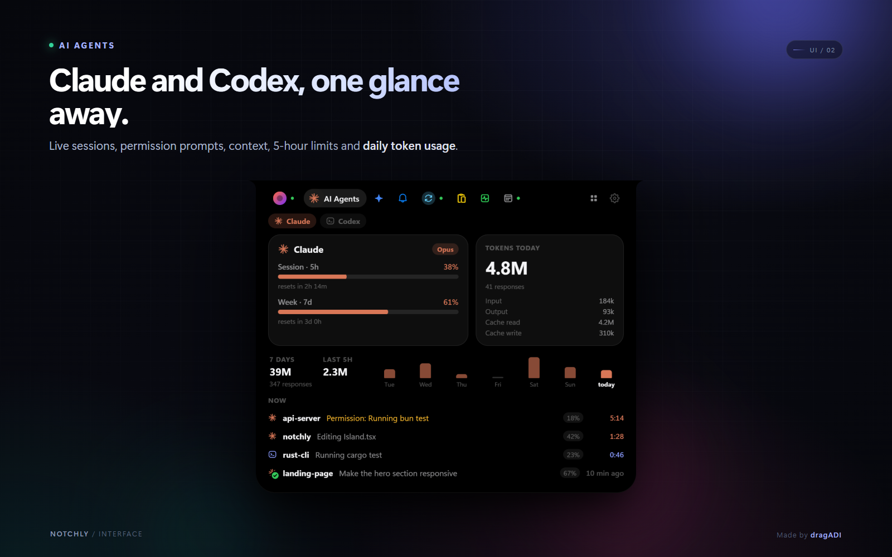
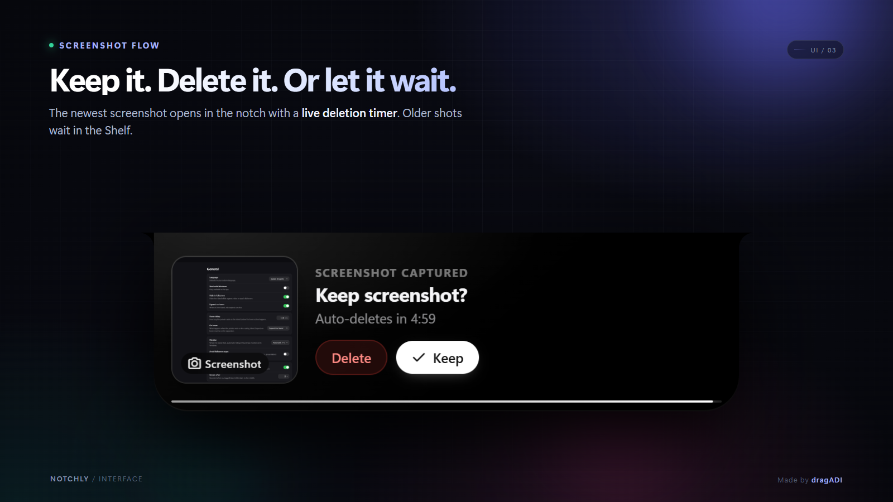
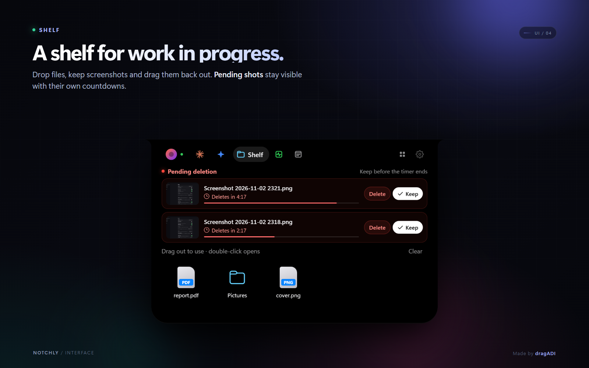
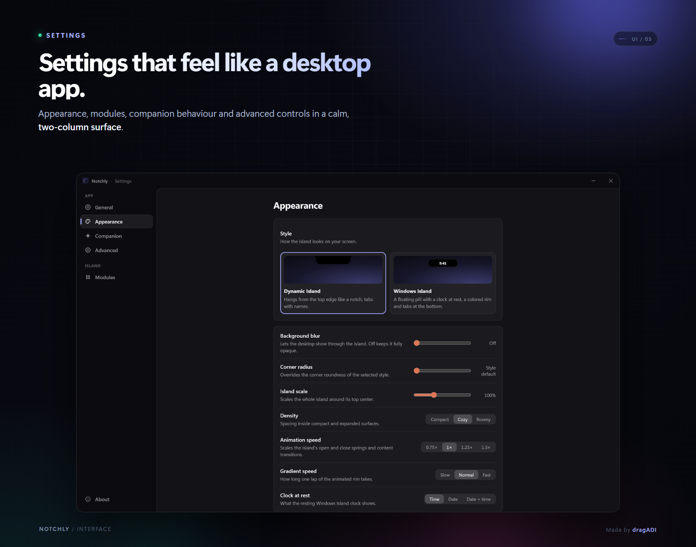

<p align="center">
  
</p>

<h1 align="center">Notchly</h1>

<p align="center">
  <b>The Dynamic Island for Windows — crafted like a product, not a widget.</b><br />
  Music, Gemini, AI agents, notifications, live activities and utilities in one quiet strip at the top of your screen.
</p>

<p align="center">
  <a href="../../releases/tag/v1.2.1"></a>
  <a href="LICENSE"></a>
  
  
  <a href="https://github.com/DragAditya"></a>
</p>

<p align="center">
  <a href="../../releases/latest"></a>
</p>

<p align="center">
  <a href="../../releases/latest"><b>Download</b></a> ·
  <a href="#frontend-engineering"><b>Frontend</b></a> ·
  <a href="#build-from-source"><b>Build from source</b></a> ·
  <a href="docs/API.md"><b>Local API</b></a> ·
  <a href="../../issues"><b>Report a bug</b></a>
</p>

<p align="center">
  <sub>Designed &amp; built by <a href="https://github.com/DragAditya"><b>dragADI</b></a></sub>
</p>

---

## New in 1.2.1

- **Multi-provider lyrics.** LRCLIB and lyrics.ovh are queried together, English originals win when both exist, and plain lyrics fill the expanded music panel when no synced version is available.
- **Absolute notch lock.** `Ctrl+Alt+L` keeps the notch idle — music, notifications, required actions, peeks and global opens cannot expand it. Ambient bubbles and the companion stay hidden while locked.
- **The 1.1.0 workflow stays.** Screenshot keep/delete cards, the pending Shelf, refined surfaces and the `com.notchly.desktop` identity are all still here.

## The interface

Notchly is not a dashboard wearing a dark theme. It is a single, quiet surface that lives at the top of Windows and opens only when you need it.

The UI is built around one idea: **the island should feel physical**. It has weight, depth, a rim that catches the light, and motion that follows the content instead of fighting it. Every module — music, AI, notifications, activities, screenshots — shares the same visual language and the same fast, keyboard-friendly rhythm.

<p align="center">
  
</p>

### The design language

- **Two native-feeling styles.** A classic black notch or a floating Windows-style pill, with matching geometry and behavior.
- **Materials, not flat cards.** Layered surfaces, hairline borders, subtle translucency, gradient rims and controlled glow.
- **Motion with intent.** Expansion, content swaps and module transitions use spring-like movement and smooth layout changes.
- **A real settings surface.** Appearance, modules, shortcuts, companion behavior and advanced controls live in a dedicated window, not a cramped popover.
- **Small details everywhere.** Live progress lines, countdowns, hover states, iconography and status feedback that make the app feel finished.

### AI agents, at a glance

The AI Agents panel follows Claude Code and Codex sessions, context, limits and token use in the same island surface — no separate dashboard, no context switch.

<p align="center">
  
</p>

## Why the frontend feels different

| Area | What makes it feel polished |
|---|---|
| **Island runtime** | A single React surface that changes shape and content without losing state or visual continuity. |
| **Motion system** | Purposeful expansion, content swaps, card transitions and a motion speed control. |
| **Visual controls** | Rim presets, custom gradients, thickness, glow, radius, scale, blur, density and idle clock formats. |
| **Screenshot card** | A large focused preview with Keep/Delete actions, a deletion countdown and a separate auto-close progress line. |
| **Shelf flow** | Pending screenshots become compact rows with thumbnails, live timers and direct actions. |
| **Settings** | Module-owned settings, live updates across windows, and a clean two-column desktop layout. |
| **Localization** | English and Portuguese (Brazil) with generated, type-safe translation keys. |
| **Performance** | React 19, TypeScript, Vite, CSS custom properties and a Tauri IPC boundary that keeps native work off the UI thread. |
| **Accessibility** | Keyboard-first flows, ARIA labels on status surfaces and reduced-motion handling for companion animations. |

## Highlights

| | |
|---|---|
| **Music & YouTube** | Now-playing artwork, track details, seek, play/pause, next/previous, a live visualizer and synced lyrics. LRCLIB and lyrics.ovh supply English-first lyrics, with plain lyrics in the expanded panel. Recognises browser YouTube videos, with a pin-out video window. |
| **Ask Gemini** | Ask a short question with `Ctrl+Alt+Space` and read the answer in the island. Bring your own Google AI API key and choose the model. |
| **AI agents** | Follow Claude Code sessions, permission prompts, plan usage and daily token activity without leaving the island. |
| **Live activities** | Volume, brightness, Bluetooth, charging, battery and Windows power-mode changes, plus custom activities from the local API. |
| **Companion eyes** | A small pair of eyes that peeks in for music, volume, battery and notifications, then disappears. Auto keeps it out of the way; `Ctrl+Alt+R` calls it and `Ctrl+Alt+Shift+R` turns Auto on or off. |
| **Notch lock** | `Ctrl+Alt+L` freezes the notch in idle: music, notifications, required actions, peeks and global opens cannot expand it, and ambient bubbles and the companion stay hidden. A locked click shakes the notch and flashes it red, or can pass through to the app below. Unlock from the shortcut, Settings or the tray. |
| **Notifications** | Mirror Windows notifications from WhatsApp, Teams, Outlook, Discord and other apps, with app icons and quick open. |
| **Screenshot workflow** | Keep, delete or defer the newest screenshot from the notch. Older screenshots wait in the Shelf with a live countdown. |
| **Utilities** | Clipboard history, screenshot shelf, find-on-screen OCR, GitHub issue counts, CPU/GPU/network monitor, clock and calendar. |
| **Make it yours** | A black notch or a floating Windows-style pill, gradient rims, multiple positions, adjustable screenshot card size, multi-monitor support, English and Portuguese (Brazil). |
| **Local-first** | No account, no analytics, no telemetry, no Notchly server. Data stays on your machine unless a feature you enable needs a service. |

## Screenshot flow

When you take a screenshot, the newest one appears in the notch as a large, focused card:

- **Keep** saves the file and adds it to the Shelf.
- **Delete** removes the file immediately.
- **Do nothing** lets the card fold back and leaves the screenshot in the Shelf as a pending item.
- The card countdown shows when the file will be deleted; the thin progress line shows when the card will close.
- The second screenshot replaces the card and restarts the timer. Older screenshots go straight to the pending Shelf.
- Pending rows show a thumbnail, a live countdown and Keep/Delete actions, and survive a restart.
- Card width and height are configurable in Settings.

<p align="center">
  
</p>

The screenshot card is intentionally a decision surface, not another panel: it pins itself open, ignores hover, and gives you only the two actions that matter. The Shelf is where the rest of the flow lives.

<p align="center">
  
</p>

## A closer look

Use **Settings → Appearance** to switch between the classic black notch and the floating Windows Island pill, then choose the rim, thickness, glow and placement.

- **Compact by default.** It stays out of the way at the top of the screen.
- **Expands when you need it.** Hover or click to open the active module.
- **Keyboard-first.** `Ctrl+Alt+Space` opens Ask Gemini; `Ctrl+Alt+F` finds text anywhere on screen; `Ctrl+Alt+R` calls the companion; `Ctrl+Alt+L` locks the notch.
- **Multi-monitor aware.** Choose a display, follow the primary monitor, or move away from fullscreen apps.
- **Fullscreen friendly.** It hides while games and fullscreen videos are running, and the companion stays quiet there too.

<p align="center">
  
</p>

## Download and install

Get the latest build — **v1.2.1** — from [Releases](../../releases/tag/v1.2.1).

Each release includes:

- `Notchly_<version>_x64-setup.exe` — per-user NSIS installer.
- `Notchly_<version>_x64_en-US.msi` — MSI installer for managed environments.
- `Notchly_<version>_x64-portable.zip` — extract anywhere and run `notchly.exe`.
- `SHA256SUMS.txt` — checksums for the published binaries.
- Source code archives, generated automatically by GitHub.

### Install with a package manager

Scoop (available now):

```powershell
scoop bucket add notchly https://github.com/DragAditya/scoop-notchly
scoop install notchly/notchly
```

winget: the manifest is submitted in
[microsoft/winget-pkgs#474260](https://github.com/microsoft/winget-pkgs/pull/474260)
and is waiting for the Microsoft CLA. Once merged, install with:

```powershell
winget install DragAditya.Notchly
```

Chocolatey: the package definition is in `packaging/chocolatey/notchly`; it still
needs a Chocolatey API key before it can be published.

### Requirements

- **Windows 10 version 2004 (build 19041) or newer**, or Windows 11.
- **WebView2** — included with current Windows 10/11, or installed automatically by the installer.
- **x64** desktop. ARM64 is not currently published.

### Installer notes

The current builds are not code-signed, so Windows SmartScreen may show a warning. If you downloaded the file from this repository and the checksum matches, choose **More info → Run anyway**. Notchly is applying for free open-source code signing; see [docs/code-signing.md](docs/code-signing.md).

The installer is per-user and does not require an administrator prompt. The portable build writes its data to your user profile and does not self-update.

### Uninstall

Use **Settings → Apps → Installed apps → Notchly → Uninstall**. If you used the portable build, delete the extracted folder and `%APPDATA%\com.notchly.desktop` to remove local data.

## Repository layout

- `code/` — the application source, package configuration and Rust backend.
- `packaging/` — winget, Scoop and Chocolatey package definitions.
- `release/` — built EXE, installers, portable ZIP and checksums. Build output is ignored by Git.
- `docs/` — documentation, screenshots and branding.
- `.github/` — CI and release workflows.

## Build from source

### Prerequisites

- [Bun](https://bun.sh) 1.3+ (or npm)
- [Rust](https://rustup.rs) with the MSVC toolchain
- Visual Studio Build Tools with **Desktop development with C++**
- Windows 10/11 with WebView2

### Run the app

Clone this repository, then from the repository root:

```powershell
.\dev.ps1
```

You can also work directly in `code/`:

```sh
cd code
bun install
bun run app:dev
```

With npm:

```sh
cd code
npm install
npm run app:dev
```

### Build installers

From the repository root:

```powershell
.\build.ps1
```

`build.ps1` builds from `code/`, copies the EXE and installers into `release/`, creates the portable ZIP and regenerates `release/SHA256SUMS.txt`. The raw Tauri output is in `code/src-tauri/target/release/bundle/`.

The default local build is unsigned, which is the easiest way to try the app. To produce signed updater artifacts, provide a Tauri signing key and run:

```powershell
$env:TAURI_SIGNING_PRIVATE_KEY = "$env:USERPROFILE\.tauri\notchly.key"
.\build.ps1 -Signed
```

You can also build from `code/` directly with `bun run app:build` or `bun run app:build:signed`.

### Frontend-only preview

```sh
cd code
bun run dev
```

The UI runs at `http://localhost:1420` with mock data. Add `#settings` for the settings window, `#settings/appearance` for Appearance, or `#pip` for the pinned video window.

## Configuration

### Ask Gemini

1. Create a Google AI Studio API key.
2. Open **Settings → Modules → Ask Gemini**.
3. Paste the key and choose a model (the default is `gemini-2.5-flash`).

The key is stored in Notchly's local settings file and is sent only to Google's Gemini API. See the [privacy policy](docs/privacy/index.md).

### Claude Code integration

Open **Settings → Modules → AI Agents → Claude Code integration → Enable**. Notchly adds HTTP hooks and a statusline bridge to `~/.claude/settings.json`, with a backup written first. Restart any already-open Claude Code sessions.

Without the integration, Notchly can still read local Claude Code transcripts, with less live detail.

### Notifications

1. Enable **Windows Developer Mode** (required for unsigned sparse package registration).
2. Open **Settings → Modules → Notifications → Enable**.
3. Notchly registers its sparse package and restarts once.

### Hotkeys

| Shortcut | Action |
|---|---|
| `Ctrl+Alt+Space` | Open Ask Gemini |
| `Ctrl+Shift+Space` | Fallback if the first shortcut is taken |
| `Ctrl+Alt+F` | Find text anywhere on screen |
| `Ctrl+Alt+R` | Call the companion |
| `Ctrl+Alt+Shift+R` | Toggle companion Auto mode |
| `Ctrl+Alt+L` | Lock / unlock the notch |
| `Esc` | Close the current panel or search |

## Local API

Notchly runs a local HTTP API at **`http://127.0.0.1:5199`**. It is bound to localhost only. Set `NOTCHLY_PORT` (or the legacy `DYNAMIC_ISLAND_PORT` / `WINDOWS_ISLAND_PORT`) to change the port.

| Method | Route | Purpose |
|---|---|---|
| `POST` | `/notify` | Transient alert; expands the island for 5 seconds by default |
| `POST` | `/activity` | Create or update a live activity by `id` |
| `DELETE` | `/activity/{id}` | Remove an activity |
| `GET` | `/status` | Current activities and media state |
| `POST` | `/claude/hook` | Raw Claude Code hook payload |

### Example

```sh
curl -X POST http://127.0.0.1:5199/notify ^
  -H "Content-Type: application/json" ^
  -d "{\"title\":\"Deploy complete\",\"subtitle\":\"api v2.3 is live\",\"icon\":\"check\",\"color\":\"#30D158\"}"
```

JSON fields: `id`, `title`, `subtitle`, `icon`, `color` (`#RRGGBB`), `progress` (`0–1`), `duration` (seconds, max 86400), `priority` (`0–99`, default `50`), `action` (an `https` link opened on click), `style` (`"level"` for a level bar), `expand` and `source`.

See **[docs/API.md](docs/API.md)** for the full reference and icon list. Client examples are in [`code/examples/`](code/examples/): PowerShell, Python and Node.

## Frontend engineering

The frontend is intentionally small, fast and direct. It is not a web app wrapped in a window; it is a UI layer designed around desktop behavior.

| Layer | Implementation |
|---|---|
| **Framework** | React 19 with strict TypeScript, rendered inside the Tauri WebView. |
| **Build** | Vite 8 with a production bundle and a browser-only mock preview. |
| **Motion** | `motion` springs, layout transitions and purpose-built CSS effects. |
| **Styling** | CSS custom properties, layered surfaces, gradient rims and density-aware spacing. |
| **State** | Typed settings, provider snapshots and live cross-window synchronization. |
| **Windows** | One bundle for the island, settings and pinned video, selected by window label. |
| **Native boundary** | Narrow Tauri commands and events keep Windows work out of the renderer. |
| **Quality** | Locale key generation, type checking, Rust tests and a Windows CI build. |

### Project shape

```
code/
  src/
    core/        island state, provider bridge, settings, appearance, i18n
    modules/     one folder per feature (music, ask, agents, activities, ...)
    settings/    dedicated settings window
    companion/   the companion eyes and mood system
    pip/         pinned video window
    locales/     English and Portuguese (Brazil)
  src-tauri/src/
    providers/   Windows-side data sources and feature backends
    window.rs    click-through overlay and hover hit-testing
    tray.rs      tray menu, hide/show and autostart
    display.rs   monitor placement and fullscreen handling
    settings.rs  local settings store and migration
release/          built EXE, installers, portable ZIP and checksums
```

More detail: **[docs/ARCHITECTURE.md](docs/ARCHITECTURE.md)**.

### Tech stack

- **Tauri 2** for the Windows shell and IPC
- **React 19 + TypeScript** for the island, settings and pinned video UI
- **Vite** for the frontend build
- **Rust** for media (SMTC), notifications (WinRT), audio sessions, display, OCR, PDH performance counters and the local API

## Privacy and security

- No Notchly account, analytics, telemetry, ads or crash reporting.
- Settings and feature data live under `%APPDATA%\com.notchly.desktop`.
- Network calls go directly from your machine to the service you enabled (Google, Spotify, GitHub, Anthropic, YouTube) over HTTPS.
- The local API listens on `127.0.0.1` only.
- Passwords copied by password managers are ignored by clipboard history.

Read the full [privacy policy](docs/privacy/index.md) and [security policy](SECURITY.md).

## Project quality

- CI runs the frontend build and Rust formatting/tests on Windows.
- Current suite: 70 passing Rust tests, with one ignored live lyrics test.
- Unit tests cover activity routing, API validation, music YouTube parsing, calendar recurrence, OCR tiling, clipboard images and more.
- Release builds are produced from tagged commits by GitHub Actions; **v1.2.1** is the current release.

## Contributing

Issues and pull requests are welcome. Start with [CONTRIBUTING.md](CONTRIBUTING.md), and use the issue forms for bug reports and feature requests. For security problems, please follow [SECURITY.md](SECURITY.md) instead of opening a public issue.

## License

Notchly is licensed under the **GNU General Public License v3.0 or later**. See [LICENSE](LICENSE) and [NOTICE.md](NOTICE.md).

If you redistribute a modified build, keep the license and all copyright notices. The complete corresponding source is this repository.

---

<p align="center">
  <b>Made with care by <a href="https://github.com/DragAditya">dragADI</a>.</b><br />
  <sub>If Notchly makes Windows feel a little quieter, consider starring the repository.</sub>
</p>
