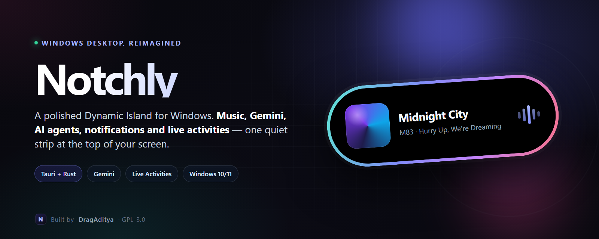
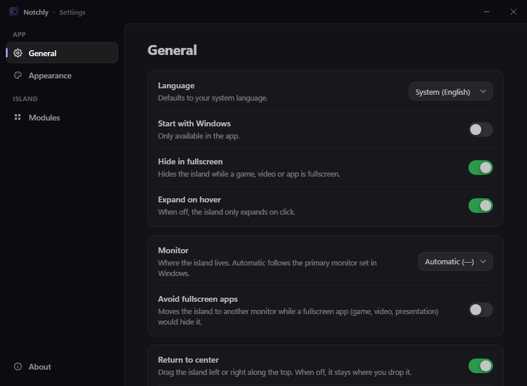

<p align="center">
  
</p>

<h1 align="center">Notchly</h1>

<p align="center">
  <b>A polished Dynamic Island for Windows.</b><br />
  Music, Gemini, AI agents, notifications, live activities and utilities — one quiet strip at the top of your screen.
</p>

<p align="center">
  <a href="https://github.com/DragAditya/Notchly/releases/latest"></a>
  <a href="LICENSE"></a>
  
  
</p>

<p align="center">
  <a href="https://github.com/DragAditya/Notchly/releases/latest"><b>Download</b></a> ·
  <a href="#build-from-source"><b>Build from source</b></a> ·
  <a href="docs/API.md"><b>Local API</b></a> ·
  <a href="https://github.com/DragAditya/Notchly/issues"><b>Report a bug</b></a>
</p>

---

## What is Notchly?

Notchly is a native-feeling Windows desktop app that puts a compact, always-available island at the top of your screen. It is designed to give you the information you need — and the controls you reach for most — without opening a dashboard or switching windows.

It is built with **Tauri 2**, **React 19**, **TypeScript** and **Rust**, and it talks to Windows APIs directly for media, notifications, audio, display and system monitoring.

<p align="center">
  
</p>

## Highlights

| | |
|---|---|
| **Music & YouTube** | Now-playing artwork, track details, seek, play/pause, next/previous, a live visualizer and synced lyrics. Recognises browser YouTube videos, with a pin-out video window. |
| **Ask Gemini** | Ask a short question with `Ctrl+Alt+Space` and read the answer in the island. Bring your own Google AI API key and choose the model. |
| **AI agents** | Follow Claude Code sessions, permission prompts, plan usage and daily token activity without leaving the island. |
| **Live activities** | Volume, brightness, Bluetooth, charging, battery and Windows power-mode changes, plus custom activities from the local API. |
| **Notifications** | Mirror Windows notifications from WhatsApp, Teams, Outlook, Discord and other apps, with app icons and quick open. |
| **Utilities** | Clipboard history, file shelf, find-on-screen OCR, GitHub issue counts, CPU/GPU/network monitor, clock and calendar. |
| **Make it yours** | A black notch or a floating Windows-style pill, gradient rims, multiple positions, multi-monitor support, English and Portuguese (Brazil). |
| **Local-first** | No account, no analytics, no telemetry, no Notchly server. Data stays on your machine unless a feature you enable needs a service. |

## A closer look

Notchly has two visual styles. Use **Settings → Appearance** to switch between the classic black notch and the floating Windows Island pill, then choose the rim, thickness, glow and placement.

- **Compact by default.** It stays out of the way at the top of the screen.
- **Expands when you need it.** Hover or click to open the active module.
- **Keyboard-first.** `Ctrl+Alt+Space` opens Ask Gemini; `Ctrl+Alt+F` finds text anywhere on screen.
- **Multi-monitor aware.** Choose a display, follow the primary monitor, or move away from fullscreen apps.
- **Fullscreen friendly.** It hides while games and fullscreen videos are running.

## Download and install

Get the latest build from **[GitHub Releases](https://github.com/DragAditya/Notchly/releases/latest)**.

Each release includes:

- `Notchly_<version>_x64-setup.exe` — per-user NSIS installer.
- `Notchly_<version>_x64_en-US.msi` — MSI installer for managed environments.
- `Notchly_<version>_x64-portable.zip` — extract anywhere and run `notchly.exe`.
- `SHA256SUMS.txt` — checksums for the published binaries.
- Source code archives, generated automatically by GitHub.

### Requirements

- **Windows 10 version 2004 (build 19041) or newer**, or Windows 11.
- **WebView2** — included with current Windows 10/11, or installed automatically by the installer.
- **x64** desktop. ARM64 is not currently published.

### Installer notes

The current builds are not code-signed, so Windows SmartScreen may show a warning. If you downloaded the file from this repository and the checksum matches, choose **More info → Run anyway**.

The installer is per-user and does not require an administrator prompt. The portable build writes its data to your user profile and does not self-update.

### Uninstall

Use **Settings → Apps → Installed apps → Notchly → Uninstall**. If you used the portable build, delete the extracted folder and `%APPDATA%\com.dragaditya.notchly` to remove local data.

## Build from source

### Prerequisites

- [Bun](https://bun.sh) 1.3+ (or npm)
- [Rust](https://rustup.rs) with the MSVC toolchain
- Visual Studio Build Tools with **Desktop development with C++**
- Windows 10/11 with WebView2

### Run the app

```sh
git clone https://github.com/DragAditya/Notchly.git
cd Notchly

bun install
bun run app:dev
```

With npm:

```sh
npm install
npm run app:dev
```

### Build installers

```sh
bun run app:build
```

Installers are written to `src-tauri/target/release/bundle/`. The default local build is unsigned, which is the easiest way to try the app:

```sh
bun run app:build
```

To produce signed updater artifacts, provide a Tauri signing key and run:

```powershell
$env:TAURI_SIGNING_PRIVATE_KEY = "$env:USERPROFILE\.tauri\notchly.key"
bun run app:build:signed
```

### Frontend-only preview

```sh
bun run dev
```

The UI runs at `http://localhost:1420` with mock data. Add `#settings` for the settings window or `#pip` for the pinned video window.

## Configuration

### Ask Gemini

1. Create a Google AI Studio API key.
2. Open **Settings → Modules → Ask Gemini**.
3. Paste the key and choose a model (the default is `gemini-2.5-flash`).

The key is stored in Notchly's local settings file and is sent only to Google's Gemini API. See the [privacy policy](docs/privacy/index.md).

### Claude Code integration

Open **Settings → Modules → AI Agents → Claude Code integration → Enable**. Notchly adds HTTP hooks and a statusline bridge to `~/.claude/settings.json`, with a backup written first. Restart any already-open Claude Code sessions.

Without the integration, Notchly can still read local Claude Code transcripts, with less live detail.

### Notifications

1. Enable **Windows Developer Mode** (required for unsigned sparse package registration).
2. Open **Settings → Modules → Notifications → Enable**.
3. Notchly registers its sparse package and restarts once.

### Hotkeys

| Shortcut | Action |
|---|---|
| `Ctrl+Alt+Space` | Open Ask Gemini |
| `Ctrl+Shift+Space` | Fallback if the first shortcut is taken |
| `Ctrl+Alt+F` | Find text anywhere on screen |
| `Esc` | Close the current panel or search |

## Local API

Notchly runs a local HTTP API at **`http://127.0.0.1:5199`**. It is bound to localhost only. Set `NOTCHLY_PORT` (or the legacy `DYNAMIC_ISLAND_PORT` / `WINDOWS_ISLAND_PORT`) to change the port.

| Method | Route | Purpose |
|---|---|---|
| `POST` | `/notify` | Transient alert; expands the island for 5 seconds by default |
| `POST` | `/activity` | Create or update a live activity by `id` |
| `DELETE` | `/activity/{id}` | Remove an activity |
| `GET` | `/status` | Current activities and media state |
| `POST` | `/claude/hook` | Raw Claude Code hook payload |

### Example

```sh
curl -X POST http://127.0.0.1:5199/notify ^
  -H "Content-Type: application/json" ^
  -d "{\"title\":\"Deploy complete\",\"subtitle\":\"api v2.3 is live\",\"icon\":\"check\",\"color\":\"#30D158\"}"
```

JSON fields: `id`, `title`, `subtitle`, `icon`, `color` (`#RRGGBB`), `progress` (`0–1`), `duration` (seconds, max 86400), `priority` (`0–99`, default `50`), `action` (an `https` link opened on click), `style` (`"level"` for a level bar), `expand` and `source`.

See **[docs/API.md](docs/API.md)** for the full reference and icon list. Client examples are in [`examples/`](examples/): PowerShell, Python and Node.

## Architecture

Notchly is a small Tauri shell around a React UI and a registry of Rust providers.

```
src/
  core/          island state, provider bridge, settings, appearance, i18n
  modules/       one folder per feature (music, ask, ai-agents, activities, ...)
  settings/      settings window
  locales/       English and Portuguese (Brazil)
src-tauri/src/
  providers/     Windows-side data sources and feature backends
  window.rs      click-through overlay and hover hit-testing
  tray.rs        tray menu, hide/show and autostart
  display.rs     monitor placement and fullscreen handling
  settings.rs    local settings store
```

More detail: **[docs/ARCHITECTURE.md](docs/ARCHITECTURE.md)**.

### Tech stack

- **Tauri 2** for the Windows shell and IPC
- **React 19 + TypeScript** for the island and settings UI
- **Rust** for media (SMTC), notifications (WinRT), audio sessions, display, OCR, PDH performance counters and the local API
- **Vite** for the frontend build

## Privacy and security

- No Notchly account, analytics, telemetry, ads or crash reporting.
- Settings and feature data live under `%APPDATA%\com.dragaditya.notchly`.
- Network calls go directly from your machine to the service you enabled (Google, Spotify, GitHub, Anthropic, YouTube) over HTTPS.
- The local API listens on `127.0.0.1` only.
- Passwords copied by password managers are ignored by clipboard history.

Read the full [privacy policy](docs/privacy/index.md) and [security policy](SECURITY.md).

## Project quality

- CI runs the frontend build and Rust formatting/tests on Windows.
- Unit tests cover activity routing, API validation, music YouTube parsing, calendar recurrence, OCR tiling, clipboard images and more.
- Release builds are produced from tagged commits by GitHub Actions.

## Contributing

Issues and pull requests are welcome. Start with [CONTRIBUTING.md](CONTRIBUTING.md), and use the issue forms for bug reports and feature requests. For security problems, please follow [SECURITY.md](SECURITY.md) instead of opening a public issue.

## Credits and license

Notchly is a separate GPL-3.0 project maintained by **[DragAditya](https://github.com/DragAditya)**. Its Windows island implementation descends from the GPL-3.0 project **Dynamic Island for Windows** by **[HeyyCzer](https://github.com/HeyyCzer)**; that upstream work and its contributors are credited in [NOTICE.md](NOTICE.md). Notchly's branding, documentation, product changes and release pipeline are maintained separately.

Copyright © 2026 DragAditya, HeyyCzer and Notchly contributors. Licensed under the [GNU General Public License v3.0](LICENSE) or later.

If you redistribute a modified build, keep the license, copyright notices and upstream credit. The complete corresponding source is this repository.
